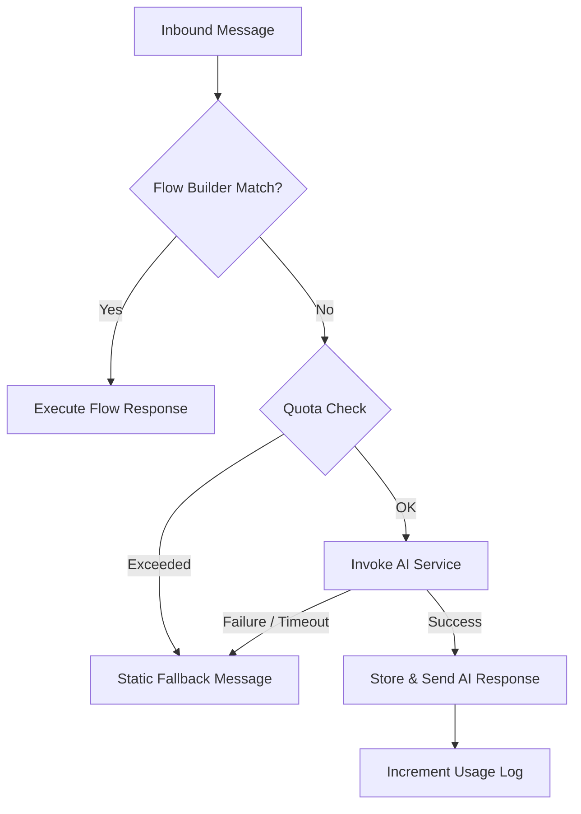

# AI Reply & Fallback System

This document outlines the architecture, logic, and configuration of the AI reply and fallback system in ReplyBase.

## Overview

The AI reply system provides automated responses across various channels (Webchat, Facebook, WhatsApp). It prioritizes Flow Builder logic, falling back to AI if no flow is matched, and finally to a static fallback message if the AI fails or quotas are exceeded.

## Flow Diagram

## Configuration

### Fallback Message
The centralized fallback message is defined in `lib/ai-fallback.ts`:
- `AI_FALLBACK_MESSAGE`: "Our AI assistant is temporarily unavailable. Please try again shortly—your request is important to us."

### Token Limits
Token limits are enforced based on the tenant's subscription plan, defined in `lib/ai-service.ts`:
- **Free**: 256 tokens
- **Starter**: 512 tokens
- **Pro**: 1024 tokens
- **Business**: 2048 tokens

### Timeouts
AI calls have a hard timeout of **15 seconds**, managed via `AbortController` in `lib/ai-fallback.ts`.

## Quota Enforcement

Quotas are checked and incremented using `checkLimit` and `incrementUsage` in `lib/subscription.ts`.
- **Tenant Identification**: Webhooks use a `__tenant:{tenantId}` prefix to enforce limits when no specific user context is available.
- **Grace Period**: A 5% grace period is applied to all limits.

## Security & Reliability

1. **Isolation**: All AI calls are strictly scoped to the `tenantId`.
2. **Secrets**: API keys for AI providers (OpenAI, Anthropic, Gemini) are managed at the tenant level and masked in UI responses.
3. **Graceful Degradation**: Any error in the AI pipeline (network, provider failure, timeout) automatically triggers the `AI_FALLBACK_MESSAGE`.
