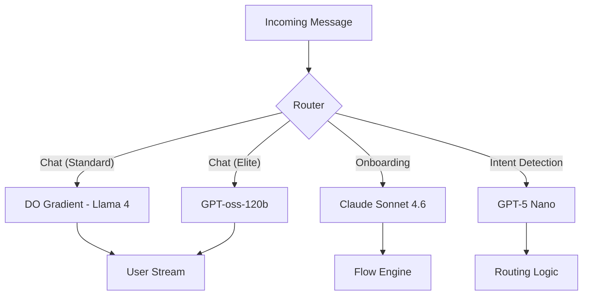

# Hybrid AI Architecture: Latency-First Orchestration

## 1. Architectural Vision
ReplyBase implements a **Tri-Provider Strategy** biased toward **DigitalOcean Gradient** for real-time interactions, using the **Target Model Catalog** to fill specific reasoning and efficiency gaps.

---

## 2. Layered Orchestration (Optimized for Speed & Margin)

### Layer A: Real-Time Chat (Internal Backbone)
*   **Target Model 1**: **Llama 4 Maverick (DO)**
*   **Target Model 2**: **GPT-oss-120b**
*   **Latency Profile**: <400ms TTFT.
*   **Primary Goal**: Instantaneous user interaction.

### Layer B: Reasoning & Onboarding (Premium)
*   **Target Model 1**: **Claude Sonnet 4.6**
*   **Target Model 2**: **OpenAI o3 mini**
*   **Latency Profile**: 0.8s - 1.5s TTFT.
*   **Primary Goal**: High-precision bot flow generation.

### Layer C: Utility & Extraction (Disruptor)
*   **Target Model 1**: **GPT-5 Nano**
*   **Target Model 2**: **GPT-oss-20b**
*   **Latency Profile**: Ultra-Fast / Async.
*   **Primary Goal**: Near-zero OpEx for intent routing.

---

## 3. The Intelligent Router (Complexity-Aware)

---

## 4. Operational Roadmap
1.  **Baseline**: Migrate all Standard Chat to **Llama 4** on DigitalOcean.
2.  **Optimization**: Inject **GPT-5 Nano** for background intent analysis to offload reasoning models.
3.  **Expansion**: Roll out **Claude Sonnet 4.6** for the "Auto-Build" bot feature.
