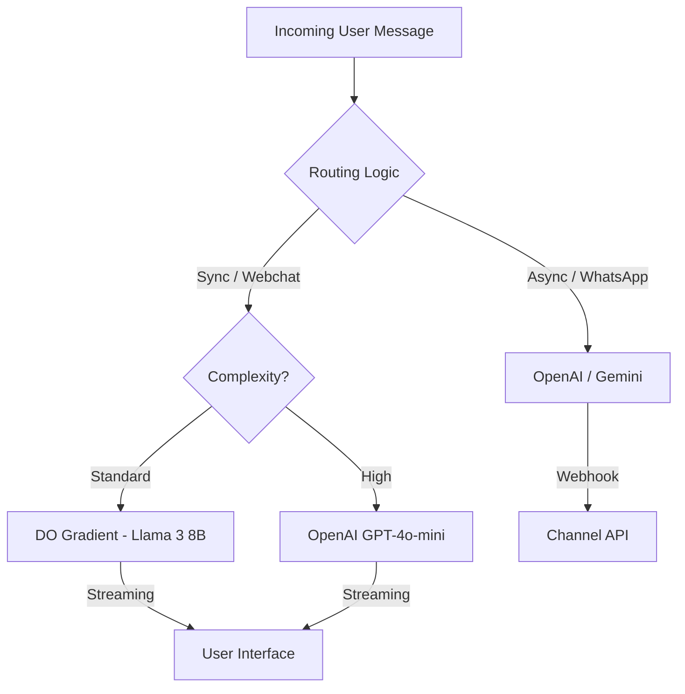

# Hybrid AI Architecture: Latency-First Orchestration

## 1. Architectural Vision
ReplyBase implements a **Tri-Provider Strategy** with a heavy bias toward **DigitalOcean Gradient** for all real-time interactions. This minimizes the "Latency Gap" that typically affects SaaS chatbots communicating over public APIs.

---

## 2. Layered Orchestration (Optimized for Speed)

### Layer A: Real-Time Chat & Utility (DigitalOcean Gradient)
*   **Models**: Llama 3 8B, Mistral 7B.
*   **Traffic Share**: 80% of Conversations.
*   **Tasks**:
    *   **Standard Customer Support**: Handling common FAQs and instructions.
    *   **Intent Routing**: Deciding which flow to trigger.
    *   **Background Tasks**: Summarization, Tagging, CRM Data formatting.
*   **Latency Profile**: **Ultra-Low (<500ms TTFT)**.

### Layer B: High-Reasoning & Sales (OpenAI)
*   **Models**: GPT-4o-mini, GPT-4o.
*   **Traffic Share**: 20% of Conversations.
*   **Tasks**:
    *   **Complex Sales Objections**: Handling difficult negotiation or edge cases.
    *   **Multi-Step Conversions**: Where extreme instruction following is required.
*   **Latency Profile**: **Medium (0.8s - 1.2s TTFT)**.

### Layer C: Long-Context & Analytics (Google Gemini)
*   **Models**: Gemini 1.5 Flash.
*   **Tasks**:
    *   **Deep Memory Extraction**: Reviewing historical logs (1M+ tokens).
    *   **Batch Template Generation**: Creating business-specific flows from large docs.
*   **Latency Profile**: **Async (Not time-critical)**.

---

## 3. The Intelligent Router (Latency-Aware)

---

## 4. Multi-Tenant Infrastructure Isolation
- **Intra-DC Connectivity**: ReplyBase Droplets connect to Gradient over DO's private network.
- **Dedicated Inference**: For Enterprise tenants, we can provision dedicated GPU droplets in Gradient to ensure zero-queueing latency.
- **Data Residency**: Keeping the "Standard Chat" layer on DO ensures that most PII never leaves the DigitalOcean cloud.

---

## 5. Implementation Roadmap
1.  **Refactor `AiService.ts`**: Implement a provider-agnostic interface with a `latency_priority` flag.
2.  **Migrate Standard Chat**: Default all new conversations to Llama 3 8B on DO.
3.  **Implement Streaming**: Use Server-Sent Events (SSE) to stream tokens directly from DO Gradient to the frontend for perceived "instant" responses.
