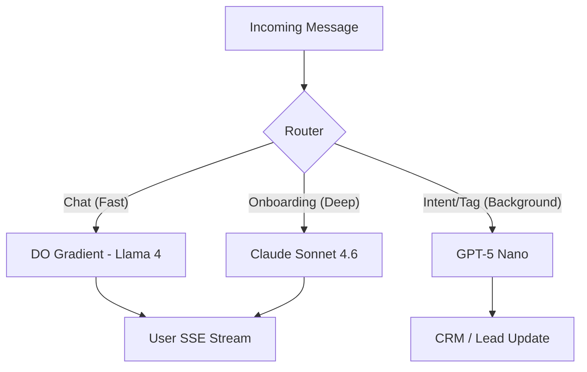

# Hybrid AI Architecture: Latency-First Orchestration

## 1. Architectural Vision
ReplyBase implements a **Tri-Provider Strategy** biased toward **DigitalOcean Gradient** for real-time interactions, with a "Disruptor Layer" for high-efficiency utility tasks.

---

## 2. Layered Orchestration (Optimized for Speed & Margin)

### Layer A: Real-Time Chat (Internal Backbone)
*   **Provider**: DigitalOcean / Local Inference.
*   **Target Model**: **Llama 4 Maverick** or **GPT-oss-120b**.
*   **Latency**: <400ms TTFT.
*   **Primary Goal**: Instantaneous user experience.

### Layer B: Reasoning & Onboarding (Premium)
*   **Provider**: Anthropic / OpenAI.
*   **Target Model**: **Claude Sonnet 4.6** or **o3 mini**.
*   **Latency**: 0.8s - 1.5s TTFT.
*   **Primary Goal**: Flawless instruction following and complex sales logic.

### Layer C: Utility & Extraction (Disruptor)
*   **Provider**: OpenAI (Next-Gen) / Qwen.
*   **Target Model**: **GPT-5 Nano** or **Ministral 3 14B**.
*   **Latency**: Async / Ultra-Fast.
*   **Primary Goal**: Near-zero OpEx for intent detection and tagging.

---

## 3. The Intelligent Router (Latency-Aware)

---

## 4. Implementation Strategy
1.  **Unified AI Service**: Centralized routing in `lib/ai-service.ts`.
2.  **Environment-Driven Logic**: Provider selection managed via `DEFAULT_CHAT_PROVIDER` etc.
3.  **Plan-Based Routing**: Automatically route Premium tenants to Layer B and Standard tenants to Layer A/C.
