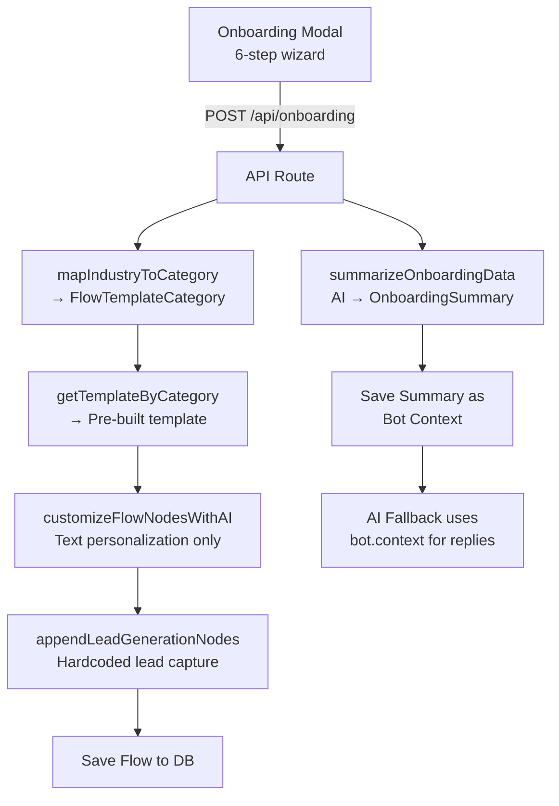

# Onboarding System Redesign — Full Audit & Plan

## STEP 1: Current System Audit

### Architecture Overview


### 🔴 Critical Issues Found

| Issue | Severity | Location |
|---|---|---|
| **Industry→Template mapping is lossy** | 🔴 HIGH | [route.ts:L75-86](file:///Users/mdamirhossain/ViveScript-Solutions/projects/ReplyBase/replybase-development/app/api/onboarding/route.ts#L75-L86) — Only 9 of 26 templates are mappable. Most industries fall through to generic "welcome" |
| **AI customization only changes text** | 🔴 HIGH | [onboarding-ai.ts:L77](file:///Users/mdamirhossain/ViveScript-Solutions/projects/ReplyBase/replybase-development/lib/onboarding-ai.ts#L77) — "Keep the structure exactly the same, only modify the 'text' fields" |
| **No conversion goal collected** | 🔴 HIGH | Schema has no field for what the user *wants* the chatbot to achieve (leads, bookings, support) |
| **Lead capture always appended** | 🟡 MED | [onboarding-ai.ts:L114](file:///Users/mdamirhossain/ViveScript-Solutions/projects/ReplyBase/replybase-development/lib/onboarding-ai.ts#L114) — Even for support-focused bots, lead gen nodes are injected |
| **No AI fallback grounding** | 🔴 HIGH | [ai-fallback.ts:L71](file:///Users/mdamirhossain/ViveScript-Solutions/projects/ReplyBase/replybase-development/lib/ai-fallback.ts#L71) — Free/Starter plans get NO system prompt. Pro/Business gets raw JSON context |
| **6 onboarding steps = high friction** | 🟡 MED | Steps 3-4 overlap significantly (Product/Service → Specifics asks same questions differently) |
| **OnboardingSummary is too generic** | 🟡 MED | 7 string fields, no structure for flow generation. Missing: CTA type, tone intensity, escalation preference |

### What Works Well ✅
- Industry → sub-industry progressive disclosure
- Customer type multi-select (structured data)
- 26 high-quality pre-built templates
- Bot context stored and available for AI fallback
- Template customization with AI is a sound pattern

---

## STEP 2: Onboarding UX Improvements

### Current: 6 Steps → New: 4 Steps

| Old Step | New Step | Change |
|---|---|---|
| 0. KYC (name, company, contact, location) | 0. **Your Business** (name, company, industry, sub-industry, website) | Merged KYC + Business Basics. Removed `location` (rarely useful for bot), moved `contactInfo` to auto-fill from session |
| 1. Business Basics (industry, size, website, model) | ↑ merged above | — |
| 2. Product/Service (offer, targets) | 1. **Your Offer** (offer description, target customers, main products) | Merged with old Step 3. Removed separate "pricing" and "USPs" textareas |
| 3. Specifics (products, pricing, USPs) | ↑ merged above | — |
| 4. Support & Sales (questions, pain, process) | 2. **Chatbot Goals** ⭐ NEW | Entirely new step with structured selects |
| 5. Additional Context (free text) | 3. **Finishing Touches** (common questions + free text) | Simplified final step |

### New High-Impact Fields (Step 2: Chatbot Goals)

```typescript
// NEW fields to add to the schema
conversionGoal: "lead_capture" | "booking" | "support" | "sales" | "engagement"
preferredCta: "call" | "whatsapp" | "email" | "form" | "booking_link"
botPersonality: "professional" | "friendly" | "casual" | "luxury"
escalationPreference: "email" | "phone" | "live_chat" | "none"
```

> [!IMPORTANT]
> These four fields are the **highest-signal inputs** for generating quality flows. The current system has ZERO structured conversion intent data.

---

## STEP 3: Updated Data Schema

### Changes to [onboarding.ts](file:///Users/mdamirhossain/ViveScript-Solutions/projects/ReplyBase/replybase-development/types/shared/onboarding.ts)

```diff
 export const OnboardingSchema = z.object({
-  kyc: z.object({
+  business: z.object({
     name: z.string().min(1).max(100),
     company: z.string().min(1).max(100),
-    contactInfo: z.string().max(200),
-    location: z.string().max(100),
-  }),
-  businessBasics: z.object({
     industry: z.string().max(100),
     subIndustry: z.string().max(100).optional(),
-    companySize: z.string().max(50),
     website: z.string().max(255).optional(),
     businessModel: z.string().max(100),
   }),
-  productDetails: z.object({
+  offer: z.object({
-    offer: z.string().max(1000),
+    description: z.string().max(1000),
     targetCustomers: z.array(z.string()),
-  }),
-  productSpecifics: z.object({
     mainProducts: z.string().max(1000),
-    pricing: z.string().max(500),
-    usps: z.string().max(1000),
   }),
-  supportSales: z.object({
+  chatbotGoals: z.object({
+    conversionGoal: z.enum(["lead_capture","booking","support","sales","engagement"]),
+    preferredCta: z.enum(["call","whatsapp","email","form","booking_link"]),
+    botPersonality: z.enum(["professional","friendly","casual","luxury"]),
+    escalationPreference: z.enum(["email","phone","live_chat","none"]),
+  }),
+  context: z.object({
     commonQuestions: z.string().max(2000),
-    painPoints: z.string().max(1000),
-    salesProcess: z.string().max(1000),
-  }),
-  additionalContext: z.object({
     otherInfo: z.string().max(2000).optional(),
   }),
 });
```

### Updated OnboardingSummary

```diff
 export interface OnboardingSummary {
   companyProfile: string;
   targetAudience: string;
   keyOfferings: string;
-  pricingStrategy: string;
-  competitiveAdvantage: string;
   commonQueries: string;
   toneAndVoice: string;
+  conversionGoal: string;
+  preferredCta: string;
+  escalationPreference: string;
   isPlaceholder?: boolean;
 }
```

> [!NOTE]
> The old schema had 6 sections with 15+ fields. The new schema has 4 sections with 12 fields. Every removed field was either unused in prompt generation, redundant, or low-signal.

---

## STEP 4: New AI Generation Prompt

The current system uses TWO AI calls:
1. `summarizeOnboardingData` — converts raw data → structured summary
2. `customizeFlowNodesWithAI` — tweaks template text

### Problem: The Two-Pass System is Wasteful
- First pass creates a summary that loses structured data
- Second pass only modifies text, never structure
- Neither pass knows about the flow builder's node types

### New Approach: Single-Pass Flow Generation

Replace both AI calls with ONE deterministic prompt that:
1. Takes structured onboarding data directly
2. Generates a complete flow (not just text modifications)
3. Returns valid node JSON that maps to our `FlowNodeContent` type

See implementation in [onboarding-ai.ts changes](#code-changes) below.

---

## STEP 5-6: Flow Generation Requirements & Output Format

The generated flow MUST use only these node types (from [flow-runtime-utils.ts](file:///Users/mdamirhossain/ViveScript-Solutions/projects/ReplyBase/replybase-development/lib/flow-runtime-utils.ts#L21-L47)):

| Node Type | Purpose | Content Fields |
|---|---|---|
| `message` | Display text to user | `text`, `delayMs`, `typingEnabled`, `typingDurationMs`, `quick_replies?`, `nextNodeOrder?` |
| `input` | Collect user data | `text`, `variableName`, `inputType` (text/email/phone/number), `validationMessage?` |
| `condition` | Branch on variable value | `conditions[]` (variableName, operator, value, nextNodeOrder), `nextNodeOrder` (default) |
| `action` | Perform side effect | `action` (tag_user/update_status/end_flow/call_flow/etc), `tags?`, `status?` |
| `wait` | Pause flow | `waitMs` |
| `end` | Terminate flow | — |

### Required Flow Structure

Every generated flow MUST follow this skeleton:

```
1. Entry message (greeting + value prop)
2. Intent detection (condition or input)
3. Lead qualification (name, email, phone)
4. Goal-specific path (booking/quote/info)
5. Tag & status update
6. Handoff message (sets expectation for human follow-up)
7. end_flow action (flow stops, waits for human support)
```

---

## STEP 7: AI Fallback Prompt

### Current Problem
- Free/Starter: NO system prompt at all
- Pro/Business: Raw JSON dump of bot context

### New Approach
Build a proper system prompt for ALL plans from the stored `OnboardingSummary`:

```
You are {{company}}'s AI assistant. You help with {{keyOfferings}}.

RULES:
- Keep responses under 2 sentences
- If the user's question is about: {{commonQueries}} → answer briefly
- For anything else → say "I'll have our team get back to you on that"
- NEVER make up prices, policies, or commitments
- NEVER continue a conversation indefinitely
- Tone: {{toneAndVoice}}
```

---

## Code Changes Required

### Files to Modify

| File | Change Type | Description |
|---|---|---|
| `types/shared/onboarding.ts` | **Schema** | New 4-section schema with structured goal fields |
| `components/onboarding/onboarding-modal.tsx` | **UI** | 4-step wizard, new goal selection step |
| `lib/onboarding-ai.ts` | **Core** | New single-pass flow generation prompt |
| `app/api/onboarding/route.ts` | **API** | Updated industry→template mapping, new data flow |
| `lib/ai-fallback.ts` | **AI** | Proper system prompt builder for all plans |
| `tests/api/onboarding.test.ts` | **Test** | Updated for new schema |

> [!WARNING]
> **Backward Compatibility:** The `onboardingData` JSON stored in `tenant.onboardingData` will have a different shape. Existing tenants who already completed onboarding are unaffected (their flows are already generated). Only new onboardings use the new schema.

---

## STEP 9: Validation Plan

After implementation, simulate these 5 business types:

| # | Business | Industry | Goal | Expected Template |
|---|---|---|---|---|
| 1 | "Sunrise Dental" | Healthcare & Wellness → Clinics/Dental | booking | Booking template with dental customization |
| 2 | "TechFlow SaaS" | Software & Technology → SaaS | lead_capture | SaaS template with lead gen |
| 3 | "GreenClean" | Home Services & Trades → Cleaning | lead_capture | Cleaning services template |
| 4 | "Luxe Cuts" | Healthcare & Wellness → MedSpas & Salons | booking | Hair salon template |
| 5 | "PropFirst" | Real Estate → Agencies | sales | Real estate template |
