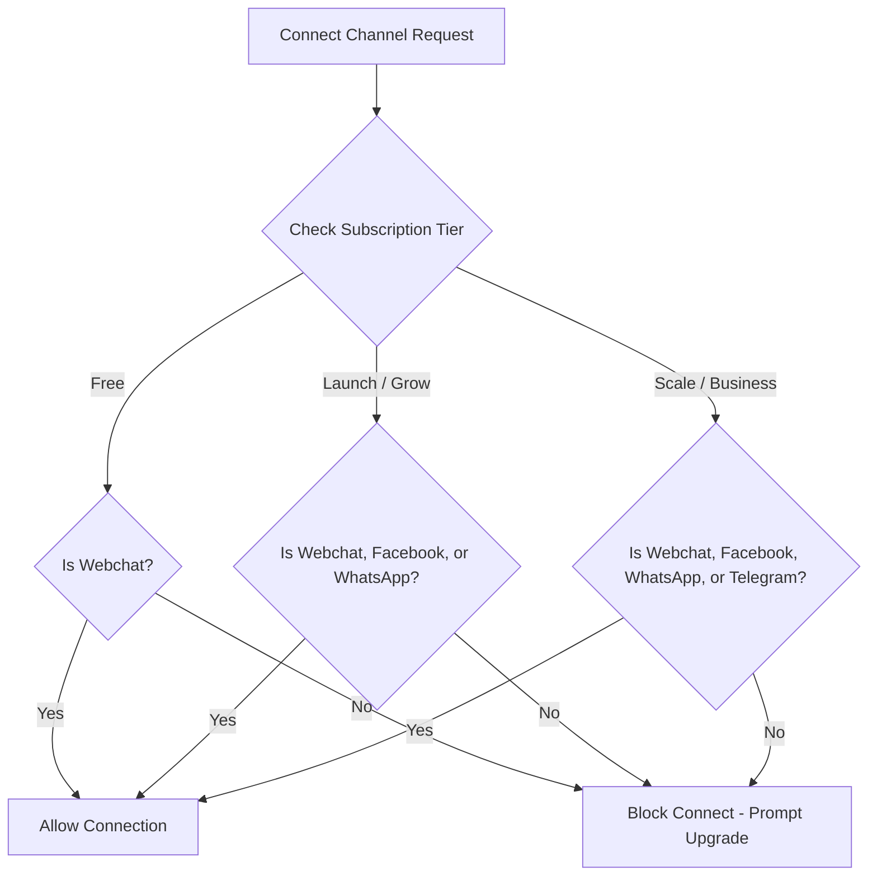

# Feature Gating Audit

This audit evaluates how resource limits, channel connections, and feature permissions are enforced across all tiers in the ReplyBase platform.

---

## 1. Resource Limits Enforced
The core SaaS platform restricts bot and automation limits inside `lib/subscription.ts` using database lookups and cache-backed checks:

### Quota Checks
- **Bots Count**: Enforced in `app/api/bots/route.ts` via `checkBotLimit`. Blocks `POST` bot creation when the user's bot count is equal to or greater than the plan's `maxBots`.
- **Flow Execution/Automations**: Tracked in `lib/subscription.ts` via `checkLimit(tenantId, "flow_execution")`. Incremented in `lib/flow-execution-engine.ts` on flow trigger. Uses a grace-zone system:
  - **Safe Zone (< 90% usage)**: Standard operation.
  - **Warning Zone (90% - 100% usage)**: Alerts the user in settings/billing.
  - **Grace Zone (100% - 110% usage)**: Standard operation, allows burst.
  - **Hard Limit (> 110% usage)**: Execution blocked, flows skipped.
- **AI Responses**: Verified in `checkLimit(tenantId, "message")` and enforced in `app/api/ai/chat/route.ts` and `lib/ai-fallback.ts`. Blocks further AI processing when limits are exceeded.

---

## 2. Channel Connection Constraints
We have implemented strict channel-type gating to ensure users can only connect integrations authorized by their subscription tier:

### Channel Specific Enforcements
- **Free**: Restricted to **Webchat** only.
- **Launch & Grow**: Allowed to connect **Webchat**, **Facebook**, and **WhatsApp**. If they attempt to connect **Telegram**, they are blocked.
- **Scale & Business**: Allowed to connect all available channels (**Webchat**, **Facebook**, **WhatsApp**, **Telegram**).

We resolved historical gating gaps by replacing count-only `checkChannelLimit` with `checkChannelLimitWithType` in the following endpoint connectors:
- `/api/bots/[botId]/channels/facebook` (POST)
- `/api/bots/[botId]/channels/whatsapp/connect` (POST)
- `/api/bots/[botId]/channels/telegram/connect` (POST)

---

## 3. CRM & API Access Controls
- **CRM & Lead Insights**: Restrictive features (lead detail pages, CRM lists, lead scoring metadata) are visible only if `subscription.plan.name !== "free"`.
- **API & Custom Integrations**: API endpoints under `/api/v1/*` verify keys. If a tenant's active plan is not `scale` or `business`, requests are immediately rejected with a `403 Forbidden` response.
- **AI Memory & Message Depth**: 
  - `grow`, `scale`, and `business` tiers receive a deeper historical message context window of **12 messages** for AI responses.
  - `free` and `launch` tiers are restricted to **6 messages** of conversational history.
